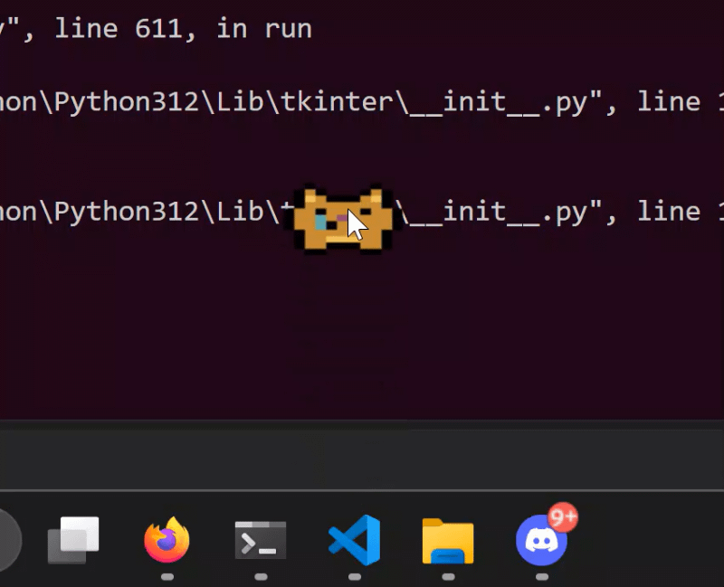

# Soggy

Soggy is a sad little desktop cat. He walks around and takes naps.

- Drag him around with your mouse.
- Left-click him for a quote.
- Right-click him to make him vanish.

Download **Soggy.exe** from the [latest release](https://github.com/Naaylla/Soggy/releases/latest).

Run Soggy with `python pet.py`.
